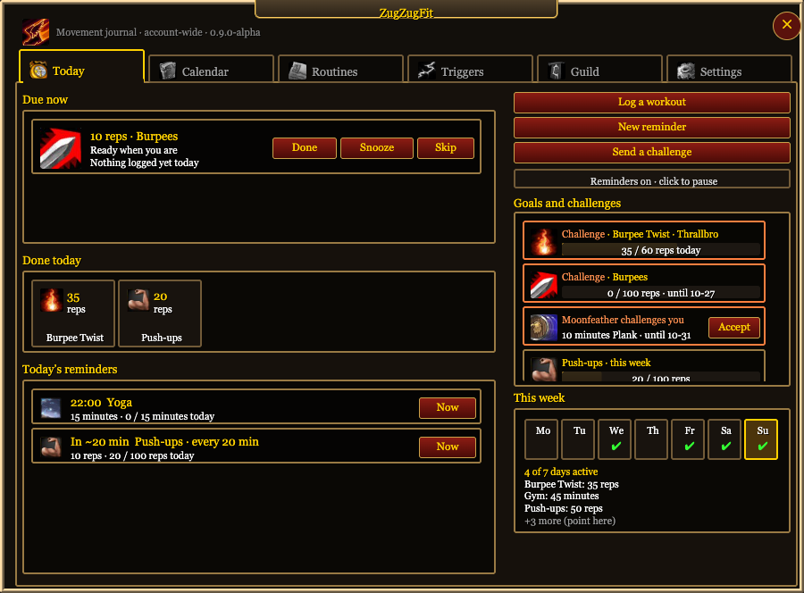
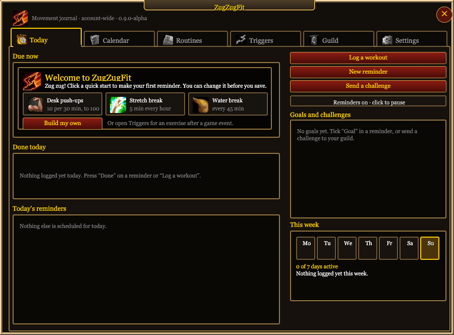
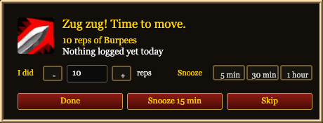
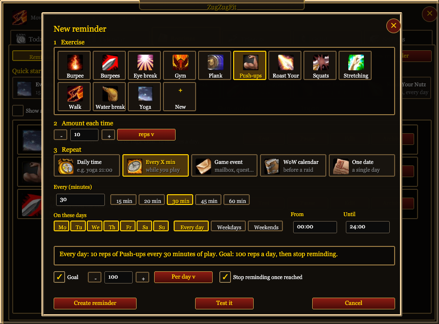
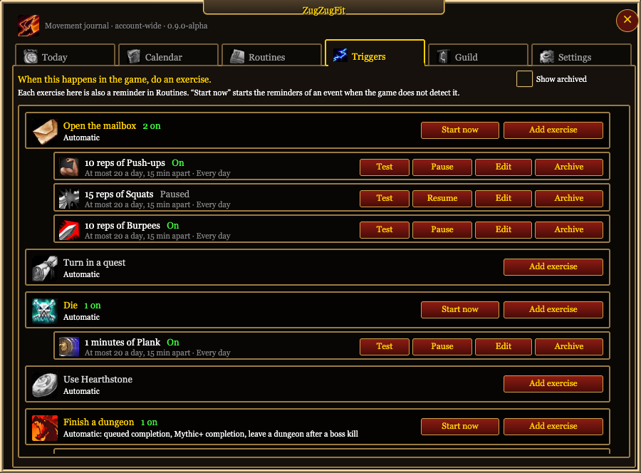
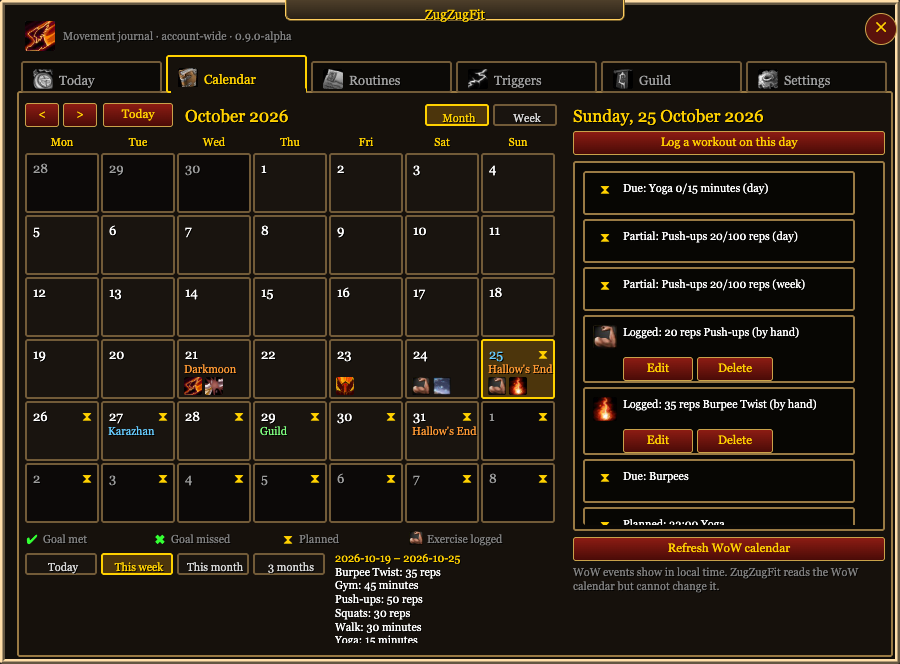
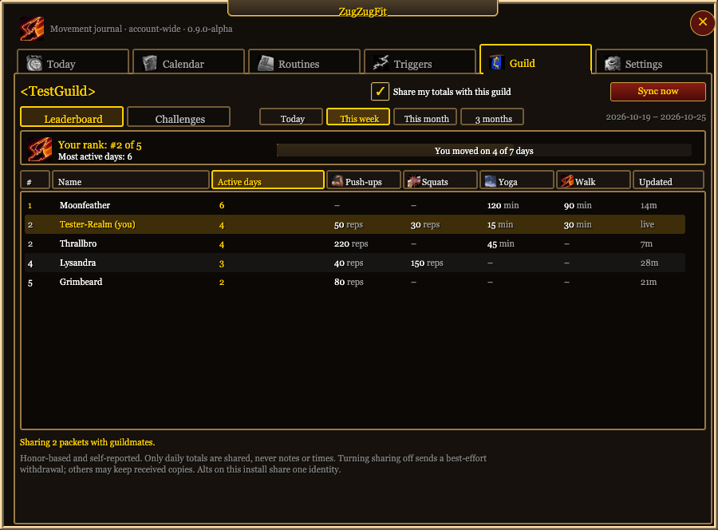
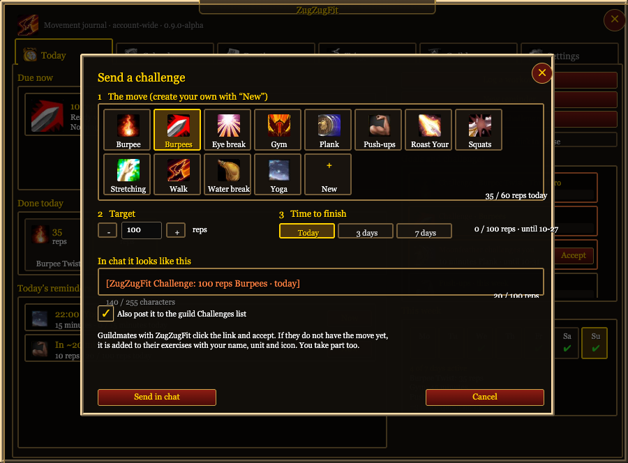
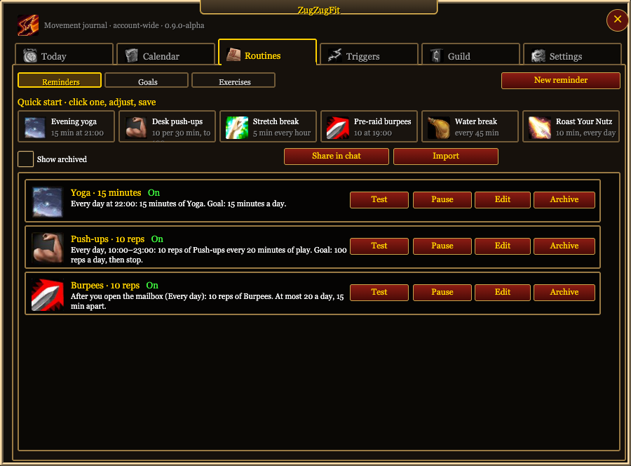

# ZugZugFit

**Zug zug! Time to move.**

ZugZugFit is a World of Warcraft addon that reminds you to move while you play. It gives you push-ups every 30 minutes, squats each time you open the mailbox, or burpees 30 minutes before a raid. It keeps a journal of what you did, shows it in a calendar, and lets you compete with your guild.

> **Status: 0.9.0-alpha.** 78 offline test scenarios and a 17-step new-user journey pass. Nobody has accepted a package in a real game client yet. Use the [in-game test plan](docs/RETAIL-TEST.md) and report what you find.

<p align="center"></p>

## Features

- **Reminders that fit your play.** Every day at a time, every X minutes of active play, after a game event, before a WoW calendar event, or on one date.
- **One click to log.** Done logs the amount at once. Undo stays for 5 seconds. Snooze is one click.
- **Triggers.** Do an exercise when you open the mailbox, turn in a quest, die, use Hearthstone, finish a dungeon, enter a new zone, eat or drink.
- **Journal and calendar.** Each day shows the icons of your exercises and a goal mark. You can add, edit or delete a past workout.
- **Goals.** For example, 10 push-ups every 30 minutes, with a goal of 100 a day. The reminder stops when you reach the goal.
- **WoW calendar.** Raids, holidays and guild events show in the ZugZugFit calendar. A reminder can start a set time before a raid.
- **Guild board and challenges.** This is an opt-in feature. The board ranks by active days. Send a challenge in chat, and guildmates accept it with one click.
- **Share routines in chat.** Guildmates import them with a click.
- **Respects your game.** Reminders wait during combat and while you are AFK. Intervals count only active play.
- **Account-wide.** All your characters on one WoW installation share the same journal.

## Screenshots

These pictures come from the addon's own Lua code, rendered in a browser through a mock of the WoW API. They are not captures from the game. Fonts and textures in the game look a little different.

| | |
|---|---|
|  |  |
| **First login.** Three quick starts, or build your own. | **The pop-up.** Done, Snooze or Skip, with one click. |
|  |  |
| **The builder.** A sentence tells you what the reminder will do. | **Triggers.** Each game event has "Add exercise". |
|  |  |
| **Calendar.** Your workouts and WoW events in one month. | **Guild board.** Ranks by active days, with a column for each exercise. |
|  |  |
| **Challenges.** One line in chat. Guildmates click it to take part. | **Routines.** Reminders, goals and exercises in one place. |

## Install

Download the zip for your game client from the [Releases](../../releases) page:

| Client | Package | Interface |
|---|---|---|
| Retail | `ZugZugFit-<version>-Retail.zip` | 120105 |
| Classic Era | `ZugZugFit-<version>-Era.zip` | 11508, 11509 |
| Forever | `ZugZugFit-<version>-Forever.zip` | 16001 |

1. Close WoW.
2. Unzip the package into `World of Warcraft/_retail_/Interface/AddOns/`. Use `_classic_era_` for Classic Era.
3. Make sure that the file `Interface/AddOns/ZugZugFit/ZugZugFit.toc` exists.
4. Start WoW and enable ZugZugFit in the AddOns list.

Install only one package for each client.

## Quick start

1. Click the minimap button, or type `/zzf`.
2. On the welcome card, click a quick start, for example "Desk push-ups".
3. Click "Test it" to see the pop-up.
4. Click "Create reminder".
5. Play. When the pop-up comes, do the exercise and click Done.

### Commands

| Command | What it does |
|---|---|
| `/zzf` or `/zugzug` | Opens the journal. |
| `/zzf test` | Shows a test pop-up. It gives no credit. |
| `/zzf sample` | Shows the window with sample data. Nothing is saved. |
| `/zzf selftest` | Checks the APIs, the templates and each page. It shows a report that you can copy. |
| `/zzf minimap` | Shows the minimap button and resets its position. |
| `/zzf import <code>` | Previews a shared routine. |

On the minimap button, a right-click pauses all reminders. Drag the button with the left mouse button to move it.

## Privacy

- ZugZugFit keeps all data in your local SavedVariables (`ZugZugFitDB`). It has no server and sends nothing outside the game.
- Guild sharing is off until you turn it on for a guild. When it is on, ZugZugFit sends only your daily totals for each exercise of the last 100 days, your name and a participant ID. It sends no notes and no workout times.
- When you turn sharing off, ZugZugFit asks online guildmates to remove your data. Guildmates who are offline can keep an old copy.
- Chat announcements are a separate setting. They are off by default.
- The board is honor-based. It is a friendly board, not a protected competition.

## Development

The addon is plain Lua with no bundled libraries. The source is in [`ZugZugFit/`](ZugZugFit/).

```sh
python3 verification/build.py            # lint and all offline tests
python3 verification/build.py --package  # also builds the three zips in dist/
```

The build reads Lua 5.4 and luacheck from a sibling `PaladinRegen/.tools` folder. Use `--lua /path/to/lua` to select a different interpreter.

### Tests

| Layer | What it checks |
|---|---|
| Unit tests (`tests/`) | Scheduling, the data model, the guild protocol, the UI and old clients. All run against a mock of the WoW API. |
| New-user journey (`tests/test_journey.lua`) | It plays a new user for one evening. It clicks only controls that a player can see, by their text. It writes the storyboard `verification/journey.html`. |
| `/zzf selftest` | Runs in the game and checks the real APIs and each page. |
| [In-game test plan](docs/RETAIL-TEST.md) | 82 manual tests in 10 sessions, each with an expected result. |

The offline tests cannot prove the look in the game, real mouse input, taint, or guild message delivery. The in-game tests cover these.

### Documents

- [Changelog](docs/CHANGELOG.md)
- [Test matrix](docs/TEST-MATRIX.md)
- [Guild protocol](docs/PROTOCOL.md)
- [Development plan](docs/DEVELOPMENT-PLAN.md)
- [Product specification](SPEC.md)
